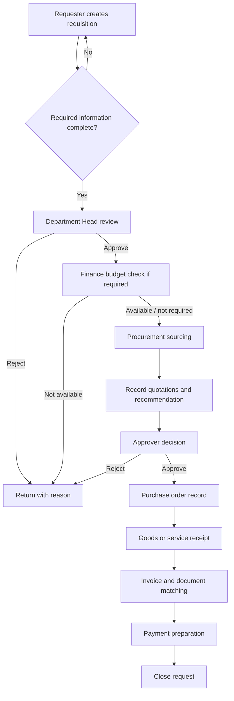

# Future-State Procurement Workflow

> Fictional portfolio demonstration.

## Status model

Draft -> Submitted -> Department Review -> Finance Review -> Sourcing -> Approval -> Ordered -> Received -> Payment Preparation -> Closed

Alternative terminal states:

- Rejected
- Cancelled
